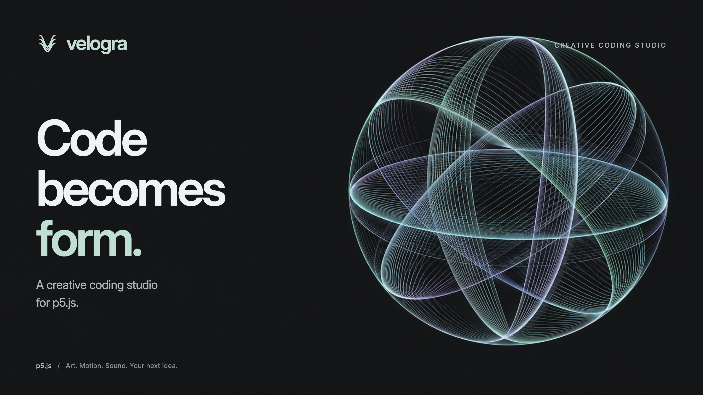

# Velogra

Velogra is a browser studio for making art, animation, and sound with p5.js, a JavaScript library for creative coding. Pick a sketch, change its colors or motion, and see what happens on the canvas. When you’re ready, open the code and make it your own.

**[Try Velogra in your browser](https://velogra.saivishnu2299.chatgpt.site)**



## Make your first sketch

1. Try **Chromatic orbit**, one of 20 starting points in the gallery. To begin from scratch, select **Blank sketch**.
2. Try the canvas controls. In Chromatic orbit, you can change the color, density, and speed without editing code.
3. Switch to **Code** to see how the sketch works. On a larger screen, **Split** puts the canvas and editor side by side. Select **Run** or **Update** to see your changes.

Velogra saves your sketches and their settings in the browser you’re using. To keep a backup or move a sketch to another device, export a **Project ZIP** and reopen it with **Import ZIP**. You can also export a **Canvas PNG** for a still image or **Standalone HTML** to run the sketch outside Velogra. Exported sketches can still need an internet connection to load their libraries.

## Creative toolkit

The toolkit pairs each of these options with a starter you can open and remix.

| Tool | What you can make with it | Starter |
| --- | --- | --- |
| p5.sound | Play or synthesize sound and draw in response to it. | Something to hear |
| Matter.js | Add gravity and collisions to moving objects. | Gravity garden |
| GSAP | Animate shapes with precise timing and easing. | Elastic rhythm |
| chroma.js | Build palettes and blend between colors. | Palette field |
| p5 WebGL | Draw 3D shapes and work with lights and cameras. | Another dimension |
| GLSL shaders | Use small programs to create effects such as ripples and gradients. | Liquid light |

WebGL and shader support are built into p5.js. The studio supports p5.js `2.3.4` and `1.11.11`. You can add other JavaScript libraries by HTTPS URL, and each sketch keeps its libraries listed in its own `index.html`.

## How Velogra is built

The project began with a ChatGPT Sites starter. The Velogra-specific pieces are the project library and starter gallery, the code editor, and the canvas that runs each sketch.

- **Interface.** React and TypeScript power the studio. CodeMirror provides syntax highlighting and autocomplete for JavaScript, HTML, and CSS. Prettier formats those files.
- **Preview.** The app assembles the sketch’s files and settings, then runs them in a sandboxed iframe so the sketch runs separately from the editor. The preview uses bundled copies of the toolkit libraries.
- **Storage.** The browser’s IndexedDB database holds project files, settings, and cached artwork previews. The Cloudflare D1 and R2 bindings from the starter are optional and currently disabled.
- **Hosting.** Vinext runs the Next.js-style app on Vite. The build targets Cloudflare Workers, and the live site is hosted through ChatGPT Sites.
- **Browser tools.** In browsers that expose WebMCP, the studio registers tools that can read the active sketch and update its existing text files.

## Run Velogra locally

Install Node.js 22.13.0 or later, then run these commands from a terminal.

```sh
git clone https://github.com/saivishnu2299/Velogra.git
cd Velogra
npm run install:ci
npm run dev
```

Open [localhost:5173](http://localhost:5173) or use the address printed by the dev server.

### Checks and production build

```sh
npm test
npm run lint
npx tsc --noEmit --incremental false
npm run build
```

Run `npm start` after building to preview the production build on your machine with Wrangler.

### Where to find things

- The [studio source](app/studio) contains the editor, project library, and canvas runner.
- The [starter definitions](app/studio/templates.ts) and [toolkit catalog](app/studio/toolkit.ts) define the example sketches and the libraries available in the studio.
- The [browser storage code](app/studio/projects.ts) and [ZIP import and export code](app/studio/project-archive.ts) handle saving and moving projects.
- The [test suite](tests) covers project storage, navigation, starters, and toolkit behavior.

To refresh the starter gallery images, run `npx tsx scripts/render-starter-previews.ts`, open [localhost:3031](http://localhost:3031), and use the verification button. The harness checks both supported p5.js versions and writes the gallery images to `public/starters/`.
